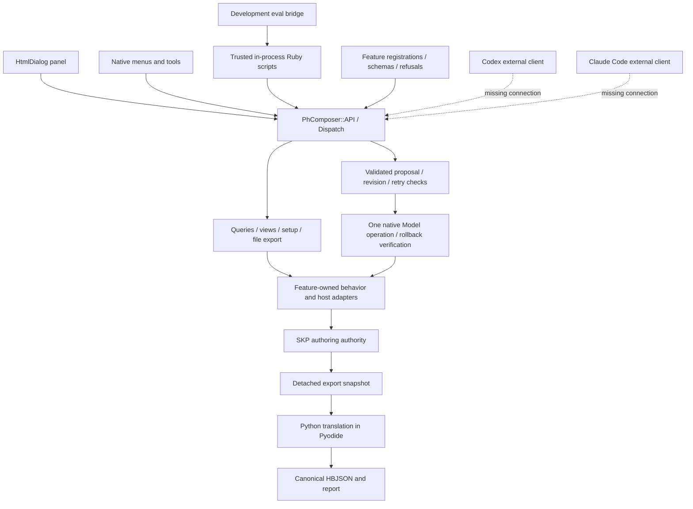
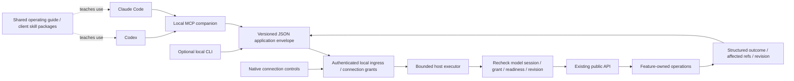
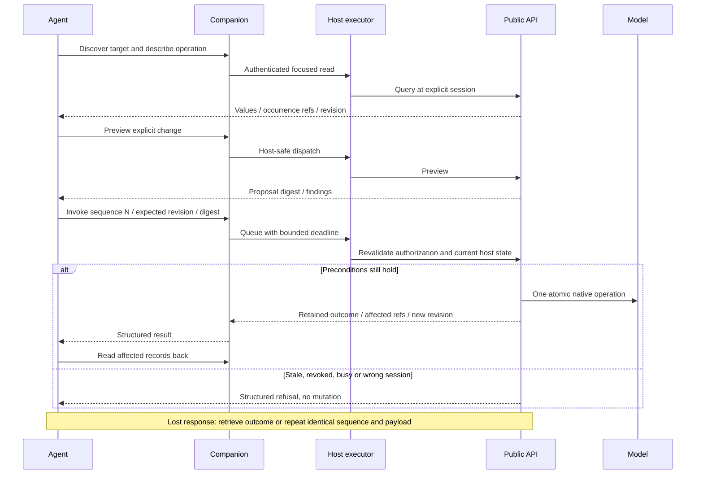

# Architecture and agent request flow

Baseline: `60982fc73af6841f0c2bc5f55136dd21cad20930`, 2026-10-17. Diagrams distinguish implemented
components from proposed ones. [Findings](FINDINGS.md) own the corrections.

## Existing application boundary

The composition root loads the same feature declarations for all clients:
[extension.rb](../../../src/ph_composer/extension.rb),
[API](../../../src/ph_composer/shell/api.rb#L23),
[dispatch](../../../src/ph_composer/shell/dispatch.rb#L13).
Registration supplies input/result schemas, examples and refusal codes. The generated reference
is a derivative of those declarations, not another operation catalog to maintain.

The dependency direction remains useful. Zones owns authored Faces and adjacency; Spaces depends
on Zones through declared reads, references and a proposal participant. Export contributors read
a detached snapshot. Python attaches Spaces to Rooms through composition; exporters consume
HBJSON. The transport should neither recalculate iCFA nor manipulate feature dictionaries.
See [Spaces export](../../../src/ph_composer/features/spaces/export.rb#L34),
[collection](../../../src/ph_composer/export/collection.rb#L17) and
[Python composition](../../../src/ph_composer/python/ph_composer_translation/composition.py#L19).

## Recommended connection boundary

This is a design recommendation, not an accepted dependency or implementation plan.

Use MCP over stdio between the local agent client and a companion process as the first transport
candidate. The companion still needs an authenticated connection into the running SketchUp host.
Stdio alone does not solve that second boundary. Investigate a local socket versus authenticated
loopback before selecting the host transport. Keep the MCP SDK out of embedded Ruby unless a
small compatibility spike proves a better outcome.

The JSON envelope identifies connection, host instance, API version, Model session, method,
operation and request. In-process contexts stay inside the host. The adapter maps its authenticated
connection to an existing approved caller and never lets a JSON field self-grant capabilities.
Keep a stable connection/caller across retries. Reconnecting must report an uncertain old outcome
rather than creating a fresh caller and blindly repeating the mutation.

Expose a small bootstrap/discovery surface and generated typed operation tools. Measure eager
versus deferred exposure with both clients; 194 tools may be too much to present at once. A generic
invoke tool can remain a compatibility fallback, but losing typed params to an arbitrary JSON bag
would discard much of the existing schema work. Participants are internal composition steps and
must remain excluded from callable tools.

## Permission and ownership boundaries

| Boundary | Owner and obligation |
| --- | --- |
| Agent account/subscription | The user and client. PH-Composer stores no LLM provider key and runs no built-in agent |
| Which local host/model may be accessed | Native connection controls and authenticated ingress; explicit target, no silent active-model fallback |
| Read/view/write/setup/export permission | Host connection authority, enforced at execution time; client prompts do not substitute for it |
| File destination | Existing approved-location authority, bound to the connection where required; opaque IDs remain useful |
| Domain validation and Undo | Existing feature operation, proposal and host adapters |
| Retry correlation | Application caller/sequence/payload digest. MCP request ID alone is insufficient |
| Long export lifetime | Model-session-owned task; client disconnect or protocol cancellation must not silently cancel it |
| Model names, notes and provider content | Untrusted data. They never alter grants or become operating instructions |
| Packaging and protocol differences | Companion/client integration layer; no feature-specific adapter branches |

Current in-process `connect` is explicitly trusted and defaults to read/view/write. Retain that
distinction in the documentation. External connection requests should start with only approved
scope, normally read for first use. The current caller registry lacks individual revocation and
connection identity; do not expose it unchanged as a user consent system.

## Mutation and recovery

The proposal, rollback and retained-outcome machinery is implemented. The authenticated ingress,
queue and external grant recheck in this diagram are proposed. The API currently runs on its
caller's thread. A native transaction must never remain open during LLM reasoning or human approval.
Preview and invoke are separate calls and invoke validates again.

A transport timeout leaves execution uncertain. Report acceptance state and preserve the sequence;
poll rather than infer failure. Before host acceptance, cancellation may remove queued work. After
acceptance, use the operation's contract. For exports, map explicit cancel to `cancel_export` and
report whether writing has already started. Preserve existing retention and restart limits unless
the owning plan deliberately changes them.
