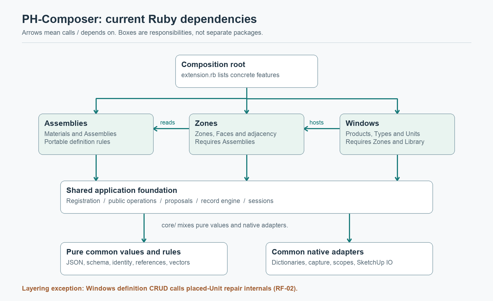
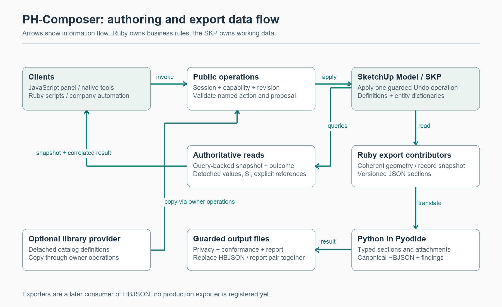
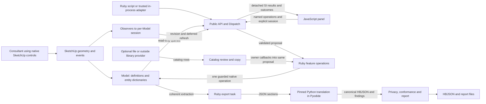
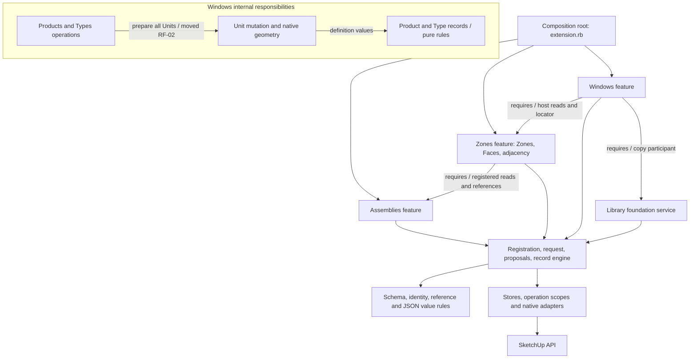
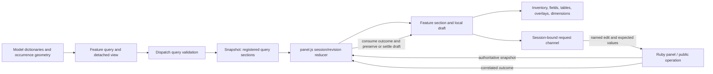
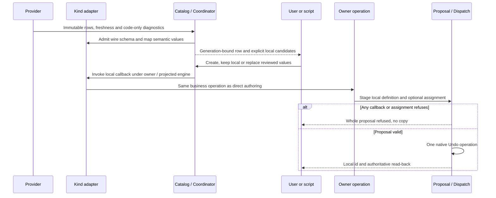
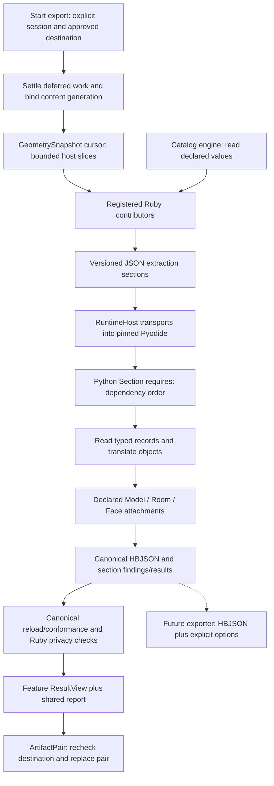
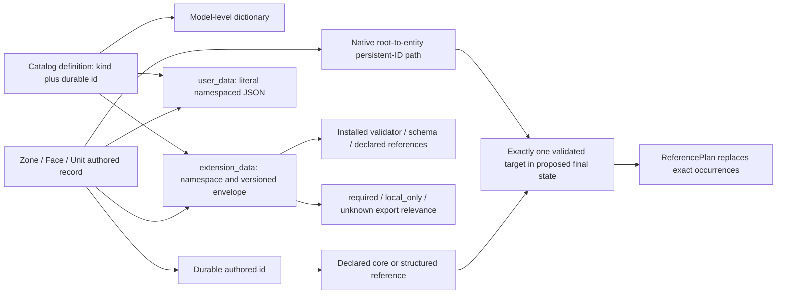
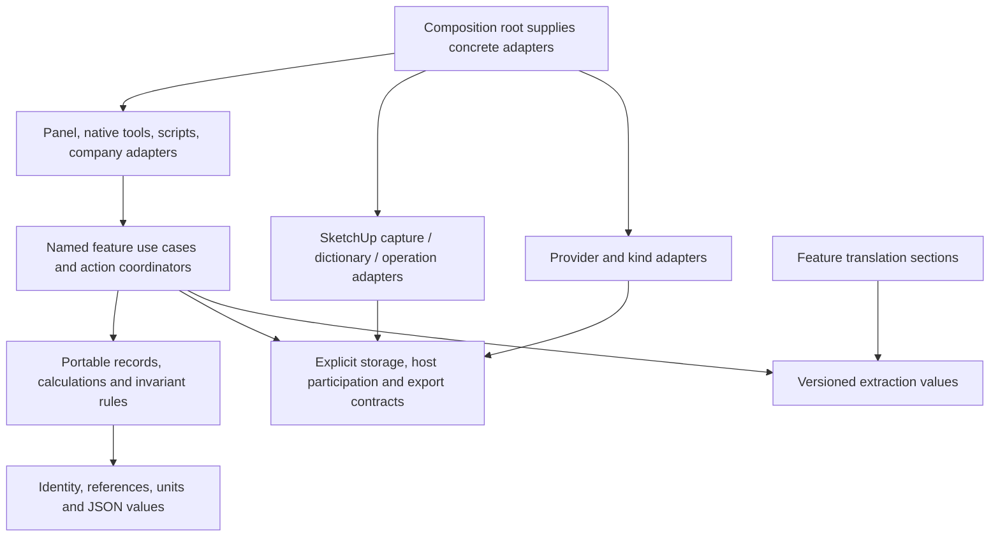

# Architecture atlas

DATE: 2026-10-13
BASELINE: `cfe01a6aad99a0e09d5ecf0de5659c606d7ba4f9`

These diagrams describe the reviewed source. Boxes collapse related files into responsibility
owners. A **dependency arrow** means the caller knows/calls the target; a **data-flow arrow** means
information travels in that direction. Neither proves that files are separately distributed packages.
Proposed corrections are identified explicitly. Follow the review sections for source evidence.

Two rendered reading aids make the broad relationships visible without a Mermaid renderer:





These are simplified maps. The diagrams below show the additional lifecycle and contribution details.

## 1. System context and runtime data flow

This diagram follows information, not imports. The Model owns the working building. The panel
is one client, and Python appears only at export.



Important distinction: the read result, not the browser's draft, is authoritative. The panel
formats quantities; Ruby owns business rules; translation constructs honeybee objects; a future
exporter consumes the resulting HBJSON. No provider controls the Model-local copy after import.

## 2. Actual feature dependencies and the onion boundary

**Dependency arrows.** At feature-registration level the graph points downward. Within Windows,
definition operations reach back into Unit preparation, which is the clearest current layering
exception. This diagram also distinguishes shared adapters from pure common values.



The target onion is **portable values/rules inside**, **use cases and proposals around them**, and
**storage, native host, UI and file/runtime adapters outside**. The source already separates many
of those responsibilities, but the filesystem does not mirror pure rings: `core/` contains both
pure rules and native adapters; shell and export services know each other's contracts. Registration
cycle checks enforce declared feature cycles, not every Ruby constant dependency.

This is reason to refine specific ports and owner boundaries, not to replace the application with
a generic plugin framework. See [01](sections/01-foundation.md) and [02](sections/02-shell-session.md).

## 3. One edit through validation and Undo

**Runtime sequence.** The same path serves a panel edit and a public Ruby script.

```mermaid
sequenceDiagram
  participant C as Client
  participant D as Dispatch
  participant S as ModelSession
  participant F as Feature operation
  participant P as Proposal / Engine
  participant H as SketchUp
  C->>D: Invoke name, params, sequence, expected revision
  D->>S: Resolve explicit caller/session and capability
  alt Same accepted sequence and digest
    D-->>C: Retained outcome, no repeated mutation
  else New accepted sequence
    D->>S: Acquire per-session exclusive scope
    D->>F: Frozen request and empty proposal
    F->>P: Stage validated records and host steps
    P-->>D: Value, affected targets, findings, digest
    D->>D: Check result, refusal, revision and preview digest
    Note over D,P: A preview stops before capture/apply
    D->>P: Capture scoped pre-images
    D->>H: Start one native operation
    D->>P: Apply host steps then catalog writes
    alt Native apply and commit succeed
      H-->>S: Commit event; advance revision/content generation
      D->>S: Retain committed outcome; release exclusive scope
      S-->>C: Change notification / snapshot and correlated result
    else Native apply fails
      D->>H: Abort ordinary native operation
      D->>P: Verify records and native scopes equal pre-images
      D-->>C: Rolled back if verified; unknown otherwise
    end
  end
```

Native-copy transparent follow-ups are a separate route: aborting a transparent operation can
affect the user's source gesture, so features use restorable writes and HostFollowUp. Do not infer
that every native mutation is an ordinary Dispatch commit. The watcher policy and evidence remain
with their owning packets.

## 4. Reads, snapshots and frontend ownership

**Data flow.** A registered query is the shared read seam. Sections read the latest snapshot; they
are all rendered, including hidden panes, so pending results can settle.



The explicit JS module graph points from feature screens to shared presentation components.
Presentation grouping and coordinates remain local. JS-01 identifies topology eligibility that
should be projected from Ruby; JS-05 identifies an area-aggregation policy discrepancy.

An optional wording hook currently runs before outcome reduction and can prevent settlement
when it throws (JS-02). That is an extension-failure boundary, separate from host mutation safety.

## 5. A library record becomes an editable local definition

**Runtime sequence.** The provider never writes the Model and supplies no privileged default.



F05 concerns a wire-label assumption between file parsing and provider sorting. RF-04 concerns
Material replacement repeating its authoring pipeline. The neutral coordinator itself has no
built-in-kind branch requiring a new case for each adapter.

## 6. Export to canonical HBJSON

**Data flow with execution checkpoints.** Extraction and translation are separate extension seams.



The dotted exporter path is a tested contract with no shipped exporter registration, not a
currently available format picker. Cancellation and content-generation checks run between task
stages; once pair writing starts, cancellation is withheld. F06/F07 identify missing Edge facts
and entity payload projections, not permission to bypass capture or privacy.

## 7. Identity, occurrence and custom data

**Relationship diagram.** Arrows are relationships, not imports. A durable identity alone cannot
disambiguate repeated geometry occurrences.



Opaque metadata strings are never inferred as object references. Copy remaps only declared
references within the copied collection. Unavailable data may be retained without being understood.
RF-01/RF-03/F07 show that entity-backed writes, status views and export projections need the same
care already given to catalog records.

## 8. Recommended boundary refinement

**Proposed dependency direction, not implemented.** These are candidate seams for later plans.



The practical steps are to tighten existing registration and participant contracts, complete
entity metadata capabilities, project domain facts to the UI, and coordinate native repair outside
definition operations. A company can then automate through the same named use cases without
learning private dictionaries, geometry repair or browser lifecycle internals.
