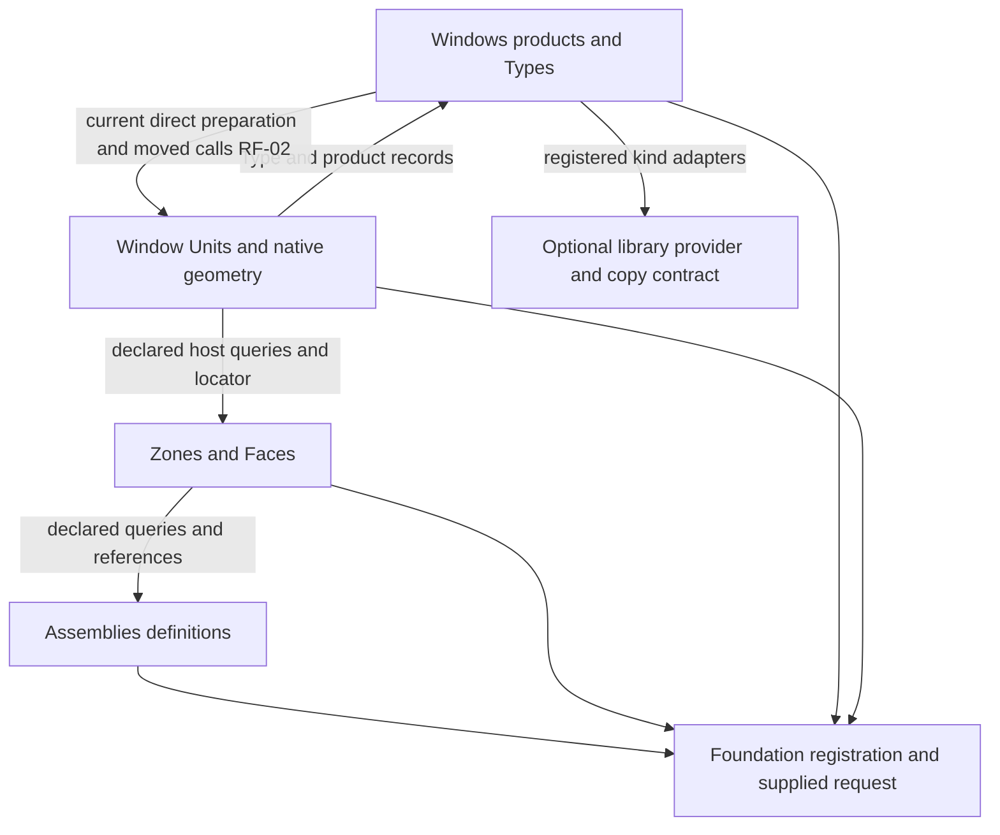
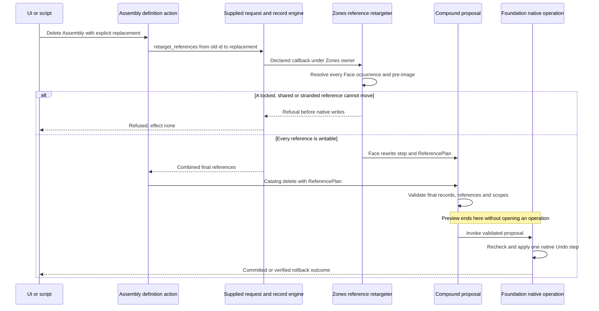

# Ruby built-in features

DATE: 2026-10-13
BASELINE: `cfe01a6aad99a0e09d5ecf0de5659c606d7ba4f9`
SCOPE: `src/ph_composer/features/assemblies`, `zones`, `windows`, and their crossings into the supplied foundation.
STATUS: Review only. No shipping implementation, commit, PR or native-host operation.

The feature-level organization is useful: installation is explicit, definitions usually reuse the record engine, cross-feature Face access uses declared reads and locators, and mutations remain proposed until the foundation owns the native operation. Three concrete contract mismatches remain. The most consequential contribution gap is that existing entity-owned records expose metadata for reading and preservation without providing the promised supported route for updating it.

## Findings

### RF-01. Entity-owned metadata cannot be maintained through the supported operations

**Classification: directly evidenced contract mismatch; high contributor cost.** The [metadata contract](../../../../context/EXTENSIBILITY.md#L604) says public operations read and update `user_data` without raw dictionary access, with Undo. This works for catalog definitions. It does not work for existing Zones, Faces or Window Units.

The [Zone update schema](../../../../src/ph_composer/features/zones/declarations/zone.rb#L28) accepts only `reference`, `values` and `expected_values`. The [Face classification schema](../../../../src/ph_composer/features/zones/declarations/faces.rb#L37) accepts only occurrence targets, classification intents and expected values. [Unit placement](../../../../src/ph_composer/features/windows/declarations/units.rb#L197) accepts initial `user_data`; its registered existing-unit operations are removal, rehost, swap, reset, identity repair, flip and restore. None accepts an updated metadata map or structured extension payload.

The entity reference-target contract is explicitly read-only. It grants no catalog persistence authority. [Catalog `propose_update`](../../../../src/ph_composer/core/records/engine.rb#L86) supports `extension_payloads`, but the feature declarations neither expose this argument for entities nor supply an equivalent validated entity operation. Adding a custom outside feature with access to a public reference locator does not authorize writing another feature's stored record.

**Concrete consequence.** A script can read a Zone's review metadata, but cannot attach or change its own review status using the supported Zone action. The synthetic probe submits an otherwise valid Zone update with `user_data`; it receives `refused / params.invalid / none`. Maintaining a structured payload on a Face or existing Unit likewise requires private storage knowledge, a new owner-specific action, or raw dictionary writes. This undermines the stated script-to-feature progression. It also makes a contributor's extension data easiest to seed in tests through private stores rather than through a public integration example.

**Minimum correction.** Add an owner-operated metadata update for each supported entity target, or a small foundation-assisted contract that delegates the write to the target's owner. Keep occurrence-qualified resolution, explicit pre-images, registered payload validation, declared-reference checks and one native proposal. Accept `user_data` and installed `extension_payloads` through distinct arguments; preserve unrelated unavailable envelopes. This needs no dynamic plugin loader and must not turn all reference targets into catalog CRUD.

**Verification.** From the public API with the panel closed, update Zone, Face and Unit metadata, re-read it, Undo/Redo, and save/reopen in the owning host gate. Cover stale metadata pre-images, locked/shared occurrences, invalid installed payloads, unrelated unavailable payload preservation, and references to missing or duplicated targets. Include one outside-feature example that performs the update without knowing a dictionary name.

### RF-02. Windows definition operations know placement internals

**Classification: directly evidenced architecture mismatch; reproduced consequence.** [The accepted layering](../../../../context/EXTENSIBILITY.md#L56) says a definition knows nothing about geometry or what uses it, and a lower layer names no higher layer. Every [product create/update/duplicate/delete](../../../../src/ph_composer/features/windows/products/operations.rb#L12) directly calls `Units::Mutation.prepare`. The equivalent [Type operations](../../../../src/ph_composer/features/windows/types/operations.rb#L12) do so too, and [Type `moved`](../../../../src/ph_composer/features/windows/types/operations.rb#L82) directly invokes Unit geometry changes and counts native occurrences.

[Preparation](../../../../src/ph_composer/features/windows/units/identity_step.rb#L50) scans all placed Units in the Model and stages identity repairs. [The identity plan](../../../../src/ph_composer/features/windows/units/identity_plan.rb#L21) refuses shared parent storage or a locked copy before the product proposal is created. The declarations pass their primary effect through [Shapes.side_effects](../../../../src/ph_composer/features/windows/declarations/shapes.rb#L24), which appends the automatic copied-identity repair behavior. That additional effect is documented in discovery.

**Concrete consequence.** With two native Unit occurrences sharing one `wun_` id, creating an unrelated Frame refuses `target.locked / effect:none` if the copied Unit is locked. Unlocking that copy and repeating Frame create both creates the Frame and changes the copied Unit's identity. The public outcome reports `identity_repaired`. A contributor implementing a catalog operation must understand placement repair, Model traversal and native scope behavior before changing a lower-layer definition workflow.

**Policy qualification.** This is not evidence that copied-Unit repair itself is incorrect: [the existing contract](../../../../context/CONTRACTS.md#L347) deliberately says the next Windows action repairs copied identities, and the current action tests exercise a Type rename doing so. Simply removing preparation would violate that policy. The problem is the location of orchestration, together with a tension between the general layering rule and the accepted broad Windows repair policy.

**Minimum correction.** Move Unit participation to an explicit feature-local action coordinator that combines definition proposals and Unit steps, leaving the lower-layer record operation independent of placement internals. Library callbacks must use the same coordinated route when policy requires it. Decide separately whether unrelated definition creation should trigger whole-Model repairs; preserve existing accepted behavior until that policy is changed explicitly. A foundation feature-name branch is unnecessary.

**Verification.** Assert discovery's declared effects and the outcome's affected occurrences for normal create/update, duplicate repair, locked copy, shared storage and unavailable copy rules. Preserve one Undo entry and all-or-nothing refusal. Exercise the library-copy route as well as direct API actions. A pure definition-operation test should require no Model geometry fixture; the coordinator test owns native participation.

**Correction 2026-10-13:** the first review read the primary effect string but missed its
`Shapes.side_effects` wrapper. The discovery-understatement claim is withdrawn. The reproduced
repair/refusal behavior and architectural dependency remain. See [the Windows boundary rationale](../WINDOWS_BOUNDARY.md).

### RF-03. Entity reads preserve envelopes but omit their understood/unavailable status

**Classification: directly evidenced read-contract mismatch.** [The records contract](../../../../context/CONTRACTS.md#L250) requires reads to distinguish understood, invalid, outdated, unsupported and unavailable extension data. Catalog views meet it through [Engine `view`](../../../../src/ph_composer/core/records/engine.rb#L47). [Zone `Schema.view`](../../../../src/ph_composer/features/zones/zone/schema.rb#L79), [Face `face_view`](../../../../src/ph_composer/features/zones/faces/operations.rb#L341), and [Unit `list`](../../../../src/ph_composer/features/windows/units/actions.rb#L55) return the raw detached envelope map without `extension_status`; their result schemas do not declare one.

**Concrete consequence.** The synthetic probe seeds an unavailable local-only envelope on a Zone. `zones.list` returns its contents exactly but supplies no status. A client must duplicate registry/version/validator logic, defer the distinction until a later copy/export refusal, or assume that retained data is understood. Classification or geometry findings do not answer this extension-specific question. This is a read-contract gap, not proof of data loss: the ordinary read and edit code preserves the payload.

**Minimum correction.** Use the existing `Records::Extension.status` semantics to build a detached status map in the owner views, with additive result-schema changes. Extract a small shared projection helper only if it eliminates actual duplication; do not manufacture a record-engine write capability for entity targets.

**Verification.** For all three targets, query the same understood, invalid, newer, outdated and absent-extension envelopes used by catalog status tests. Assert status equality with the foundation implementation, detached read results and no revision/Undo change. An unavailable payload must remain byte-for-byte equivalent after an unrelated edit and save/reopen.

### RF-04. Material library replacement repeats the ordinary persistence pipeline

**Classification: optional maintainability improvement; no reproduced incorrect result.** [The operation reuse rule](../../../../context/EXTENSIBILITY.md#L92) says library assignment/replacement calls the same business operation as its action. [Windows product replacement](../../../../src/ph_composer/features/windows/library_kinds.rb#L88) follows that pattern. [Material replacement](../../../../src/ph_composer/features/assemblies/library_kind.rb#L79) repeats record lookup, name validation, command invocation, changed-field extraction and `propose_update` instead of calling `Materials::Operations.update`. Its legitimate difference is updating coordinator-owned `source` provenance, which the ordinary editing command excludes.

This creates a second persistence path to update when normal Material behavior changes. It currently retains the same validation and pre-image guard, so it is not a correctness blocker. The smallest improvement is one shared trusted update operation with a separate provenance argument reserved for the library callback, preserving the public editable-field allowlist. Test equivalent ordinary/library value changes and preservation of unrelated metadata; no additional generic abstraction is needed.

## Inventory and ownership

The inventory covers 149 Ruby files and 18,601 physical lines: Assemblies 24/2,012, Zones 52/8,930 and Windows 73/7,659. These are physical counts, not complexity measures. The review used a complete file/dependency scan followed by targeted source reads and the representative operation traces below. It does not claim every line of every native geometry algorithm received an independent proof.

| Subpart | Ownership and boundary | Review observations |
| --- | --- | --- |
| Assemblies install/declarations | Record kinds, CRUD, layers/segments, inventories, library adapter, export and codes | Explicit install; no Zone or Window stores are read. Shape construction comes from declared kinds. |
| Materials/Assembly schemas | Detached defaults and validation, catalog references | Material references are declared at nested Layer-Segment leaves. Ordinary metadata stays outside authored values. |
| Assembly commands | Detached edits, duplicate nested identities, material replacement | Commands return a typed `Change`; no SketchUp or transaction calls. Air-barrier Layer references follow regenerated Layer ids. |
| Assembly thermal/validation | Ruby calculations and export conditions | Missing authoring inputs remain conditions; the exact Cartesian calculation has a bounded path budget and withholds a result beyond it. No performance claim was inferred from that budget. |
| Assembly snapshots/source/library/export | Projection, provenance, optional catalog mapping, output projection | Authored values stay distinct from display defaults; unreadable catalog rows are reported separately. Library provenance mapping uses allowlists, with RF-04's duplicated replacement path. |
| Zone schema/options | Zone versions, managed Building Segments/Levels, defaults, adoption | Option definitions are within the owning Zones feature. Portable choice evidence is recovery data; adoption is explicit. Metadata update/status gaps remain. |
| Zone occurrence/index/operations | Native path resolution, editable scope, Make/Edit and independence | Ids prove identity and paths prove occurrences. Shared, nested and locked storage are checked before proposal writes. Native names remain the projection authority. |
| Zone steps/repair/split-identity | Grouping, Make Unique, record/stamp rewrites, explicit repairs | Logical copy mapping is planned before native references exist; apply rechecks the isolated contents before writing. Copies preserve literal metadata and use declared extension copy rules. |
| Zone names/copy watcher | Per-session state, native observer reports, deferred follow-up | State is session-owned; transparent work uses `HostFollowUp` with restoration rather than aborting the user's source transaction. This review did not renew host acceptance. |
| Faces schema/operations/steps/selection | Classification, Attached zones, native tools/menus, location and references | Owner performs record writes. Selection and viewport changes use view commands; native action entry points use the public API. |
| Face Assembly assignment | Dependency reads, assignment and incoming-reference rewrites | Zones requires Assemblies; lookup is through registered queries, deletion participation through a reference retargeter. Assemblies does not name Faces. |
| Adjacency overlap/plan/split/native steps | SI pair rules, scoped planning, host cuts and reciprocal stamps | Pure overlap calculations are separate from native cutting. The broader `Adjacency` planner is a host adapter, not a pure function despite sharing pair utilities. Missing survivor identities are checked after a native cut and can trigger rollback. |
| Windows product/Type schema/grid/thermal/graph | Detached definitions, inclusive band layouts, installation edges and thermal values | Calculations receive explicit records/products/settings. Type layout identity differs from catalog identity. Products intentionally share a schema-driven operations module. |
| Windows declarations/settings/library/InstallSave | Registration, optional provider copies, atomic product-and-assignment draft save | Generic library participant is a declared dependency. Temporary product ids are resolved into authored installation slots; metadata strings are not remapped. |
| Window Unit records/occurrences/read context | Instance targets, occurrence walks and public Zone host context | Windows reads no Zone dictionary. Hosts come from `request.query`/`locator` and supplied Face geometry. Repeated occurrences and Units outside Zones participate in identity/reference checks. |
| Window placement/tools | Detached planes, polygons, offsets and fit; host tool adapter | Pure geometry uses metres; only native adapters touch SketchUp pick state, glue and instance storage. Tool writes use the same named placement action. |
| Window Unit native steps/repairs | Primary definition generation, placement/swap/reset/remove/rehost/restore/flip | Step descriptors bind detached records and native pre-images. Mutation scopes include definitions, shared materials, glue and Unit state beyond an Entities collection. RF-02 reaches these internals from definition operations. |
| Window export/assessment/areas | Detached export assessment, aperture projection and area queries | Cross-feature sections are declared. Area values are withheld when native findings make geometry uncertain. Export mapping gaps are reviewed in the foundation/export section. |

## Actual dependency shape



The feature-level registration graph is acyclic: Assemblies has no feature requirements; Zones requires Assemblies; Windows requires Zones and Library. The reverse edge is **inside Windows**, where declaration-level orchestration and lower-layer persistence are combined. It is not a hidden dependency from Zones to Windows or a foundation hard-coded feature branch.

## Representative operation traces

### Material edit, duplication and replacement

[Material registration](../../../../src/ph_composer/features/assemblies/declarations/records.rb) unpacks one request into [Materials operations](../../../../src/ph_composer/features/assemblies/materials/operations.rb). Update reads the stored record, checks the name, invokes the detached command, then stages only changed values and the caller's expected values. The engine owns metadata preservation, schema/reference checks, proposal application and native transaction ownership. No host object crosses into the Material command.

Duplicate uses `propose_duplicate` for catalog identity, metadata and extension copy rules. Its authored-values transform adjusts the name, datasheet choice and derived source. Assembly duplicate additionally regenerates Layer/Segment ids and remaps the air-barrier Layer id. It leaves shared Material references intact. Unavailable required copy rules refuse the proposal; no hand-written metadata clone bypasses the engine.

Deleting a Material with a replacement stages edits to all Assembly Layer-Segments that declare it, guards each complete `layers` pre-image, then stages the catalog deletion. Replacement by a membrane in a mixed Layer refuses. This is intra-feature reference ownership. Deleting an Assembly uses the generic reference-retargeter seam, so the definition owner need not know which geometry feature uses it.



### Zone Make/Edit, classification and independence

Make validates explicit entities and active edit context, plans deterministic identity and managed choices, and adds a `MakeZoneStep`. Automatic Suggest is a second step in the same proposal; its Face references are produced after grouping through created slots. It reuses normal classification planning, checks settings again, and remains within the outer Undo/rollback boundary. Because its nested classification proposal is built during apply, native coverage is necessary for refusal after grouping; an offline preview is not complete evidence for that lifecycle.

Edit resolves a writable occurrence, refuses required option adoption and changed expected values, deep-copies the current record, validates the candidate, and adds a step carrying full before/after records. Apply rechecks the entire record before writing Zone attributes, native name and membership stamps. Ordinary edits preserve `user_data`/`extension_data`; preservation alone does not solve RF-01 or RF-03.

Classification first resolves all chosen Faces and expected values, plans retirement of any reciprocal Surface pair the change invalidates, and creates one `ClassifyStep`. Apply resolves/checks every pre-image before any Face write. Assembly-only assignment leaves classification and reciprocal pair data intact and uses the public Assemblies lookup for hint filling.

Independence plans Zone/Face identities and extension reference remaps, refuses unsuitable occurrence storage, and binds logical record contents before native Make Unique changes persistent ids. Apply isolates Group storage, rebuilds the plan using the same id map, checks contents against preview, and writes the owner records. Automatic native-copy follow-up retains restorable pre-images and commits restoration on failure rather than aborting a transparent operation. The scope does not imply an implemented lifecycle for all future placed children.

### Window definition edit, placement and repairs

Product/Type CRUD first invokes whole-Model Unit identity preparation (RF-02), then stages catalog changes. Type update/grid gestures additionally compare before/after geometry signatures, collect publicly resolved hosts and conflict polygons when geometry changes, and add a native `TypeChangeStep` only when required. It rechecks primary definition ownership, native state, all canonical users and fit. Metadata-only record changes do not rewrite geometry, but still reach Unit preparation and native capture logic.

Placement builds a Unit identity, resolves the host through the public Zone Face target, reads the Type, converts offsets through the detached placement plane, and proposes a `PlaceStep`. The step owns generated primary definition reuse/creation, pane stamps, anchor transform and glue. Primary definition indexes, dictionaries, relevant definitions/materials and instance transforms enter the scope fingerprint. A failing native apply is the foundation's abort-and-verification problem; preflight cannot promise rollback certainty.

Swap/reset/remove/restore/flip each have a named owner step. Swaps merge the new Type into the existing Unit record, retaining metadata. Removal supplies typed reference removals with original full-record pre-images and checks incoming references; it refuses silently erasing nested Units. Restore is deliberately limited recovery from stamped panes, not a claim to recreate the exploded instance's missing metadata. Identity repair allocates distinct Unit ids, copies literal metadata independently, and applies structured reference copy rules against a typed final reference plan.

## Contributor cost and proportionate improvements

A contributor changing Material validation can start with `materials/schema.rb`, `commands/material.rb` and focused record tests. The model operation, declaration shapes, library semantic fields and export projection are identifiable neighbors. RF-04 is the one extra replacement path they must currently remember.

A contributor adding a Frame field starts with `products/schema.rb`, then its explicit thermal use and export assessment. The product adapter derives semantic fields from the kind; the authoring operation stays per kind/collection. The current contributor must also understand Unit copy repair to predict why creating that catalog record may refuse or rewrite geometry-owned identities. RF-02 would reduce that requirement without splitting Windows into separately distributed packages.

A contributor attaching structured analysis metadata to a Face has the greatest avoidable cost: reference discovery and reading are published, but the write contract stops at a read-only target. RF-01 requires an owner-authorized operation, not more documentation about a private store. RF-03 can reuse the existing status semantics rather than ask each contributor or client to invent them.

The larger Zone/Face files reflect cohesive host lifecycles, not proof that a framework or mechanical file split is needed. Preserve pure `Overlap`, grid, thermal, definition-plan and transform functions. If extracting additional helpers, use a real repeated rule or a boundary that eliminates host setup from domain tests; raw line counts do not justify fragmentation.

## Verification and limits

Reproducible review assertions are retained in [ruby_feature_probes.rb](../evidence/ruby_feature_probes.rb). From the repository root:

```sh
"$(rbenv which ruby)" -Itests planning/archive/code-review/evidence/ruby_feature_probes.rb
```

On Ruby 3.2.2: **2 tests, 29 assertions, 0 failures, 0 errors, 0 skips**. An earlier scratch probe inheriting the existing Window action test class also completed 50 runs/739 assertions; the retained evidence avoids that inherited repetition and isolates the two review scenarios.

These are synthetic tests of public dispatch and the repository SketchUp stub. No native SketchUp session, save/reopen, support-floor host, licensed model, performance benchmark, shipping file edit, or release check was performed. The parent review owns the baseline suite and complexity measurements; this section does not duplicate its broad gate. Source analysis establishes RF-01 through RF-03 as contract gaps, and the probe directly establishes the two stated runtime consequences. It does not establish additional data loss, an actual host rollback failure, or the correctness of every polygon partition case.
