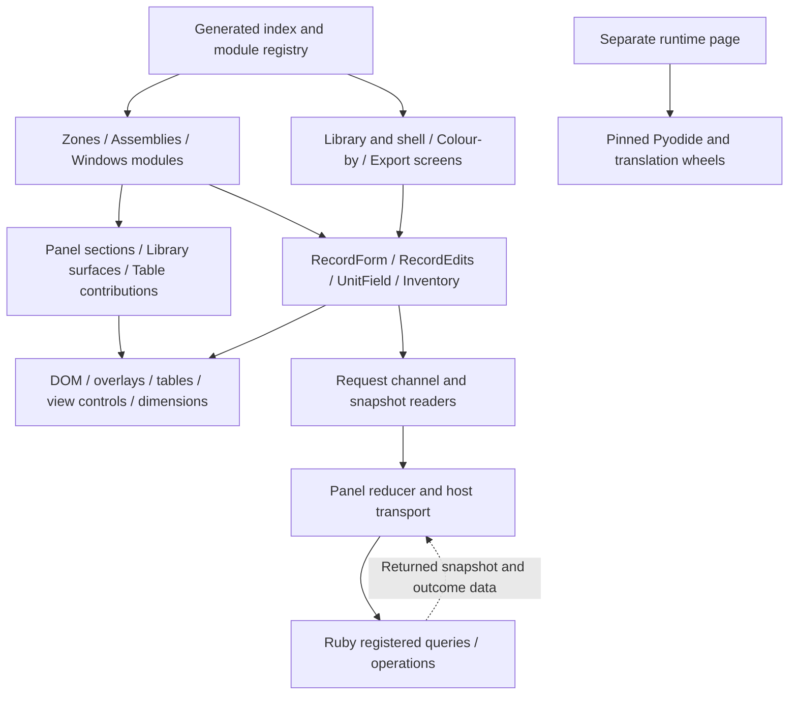

# JavaScript architecture and extensibility review

DATE: 2026-10-13  
BASELINE: `cfe01a6aad99a0e09d5ecf0de5659c606d7ba4f9`  
SCOPE: Review only. No shipping source, examples or tests changed.

The panel has a workable modular architecture. Features consume the shared kit through explicit
module dependencies, register their own sections and Library surfaces, and send validated operations
through the same request channel. The foundation has no import of a feature module. The most useful
next corrections are narrower: remove duplicated installation topology rules, repair the contributor
example's form lifecycle, and protect correlated outcomes from optional presentation-hook failures.

## Findings

### JS-01: Window installation eligibility duplicates Ruby domain rules

**Classification:** Directly evidenced ownership violation; correction recommended before extending
installation topology. No current disagreement between the two classifiers was demonstrated.

**Evidence:** [editor_shared.js:25](../../../../src/ph_composer/html/features/windows/editor_shared.js#L25)
walks neighboring grid cells and decides `perimeter`, `shared` or `partial`.
[install_editor.js:89](../../../../src/ph_composer/html/features/windows/install_editor.js#L89) uses that
answer to allow painting, and [install_editor.js:233](../../../../src/ph_composer/html/features/windows/install_editor.js#L233)
uses it to display shared zero and refuse partially shared edges. This is authoring eligibility,
not only drawing geometry. The same rule belongs to [Grid#classify](../../../../src/ph_composer/features/windows/types/grid.rb#L42)
and [Installs.paint](../../../../src/ph_composer/features/windows/types/installs.rb#L33) in Ruby. Copy
compatibility is also independently decided by JavaScript's
[topology](../../../../src/ph_composer/html/features/windows/install_editor.js#L10) and Ruby's
[Installs.topology](../../../../src/ph_composer/features/windows/types/installs.rb#L61).

**Governing rule:** [CODING_STANDARDS, Layering](../../../../context/CODING_STANDARDS.md#layering) assigns
business logic to Ruby; [EXTENSIBILITY, Organization and dependencies](../../../../context/EXTENSIBILITY.md#organization-and-dependencies)
requires the UI to consume published contracts without domain calculation.

**Consequence:** A topology change requires the contributor to find and change two algorithms in two
languages. Drift can offer a staged edit that Ruby later refuses, or hide an edit Ruby accepts. Ruby
still validates Save, so this evidence does not establish an invalid persisted assignment.

**Minimum correction:** Publish dimension-independent edge classifications and a canonical compatible
copy descriptor with each Type, using Ruby's existing Grid/Installs rules. The detached Installs
session changes products and assignments, not topology, so it can retain those facts with its baseline.
Keep JavaScript's coordinates, scale, hit targets and staged assignment display local. Do not use
thermal completeness as the availability gate: the current thermal calculation returns no element
details when dimensions are missing ([thermal.rb:25](../../../../src/ph_composer/features/windows/types/thermal.rb#L25)).

**Verification:** One synthetic topology fixture family covering perimeter, fully shared, partly
shared, Empty and merged spans; assert Ruby projection, UI eligibility and Save validation agree.
Include missing dimensions and independent element IDs in compatible copies. Existing
`window_editor_test.js` already checks shared-edge exclusion, compatible copying and incomplete
drawings; extend those cases around the published facts rather than testing a second classifier.

### JS-02: An optional outcome translator can strand an unrelated requesting view

**Classification:** Reproduced extension-boundary failure using an injected throwing translator.
No shipped translator was observed throwing on the reviewed baseline.

**Evidence:** [panel.outcomeText](../../../../src/ph_composer/html/panel.js#L434) registers arbitrary
presentation callbacks; [outcomeWords](../../../../src/ph_composer/html/panel.js#L435) invokes them
without isolation. [reduceActionResult](../../../../src/ph_composer/html/panel.js#L76) invokes that hook
before returning the updated result slot. A throw escapes
[receive](../../../../src/ph_composer/html/panel.js#L159), so the correlated outcome is never recorded.
The Zones screen legitimately uses this seam
([overview.js:1107](../../../../src/ph_composer/html/features/zones/overview.js#L1107)).

**Probe:** Register a translator that throws `broken contributor translator`, start a request channel,
and receive its refused `action.result`. `receive` throws, `state.ui.actionResult` remains null and
`channel.busy()` remains true after consuming the panel state. The operation's host refusal exists,
but the requesting editor cannot settle or release its pending UI.

**Governing rule:** The panel's section isolation and presentation-only behavior are documented in
[TECH_STACK, Panel](../../../../context/TECH_STACK.md#panel). The translator should improve wording
without becoming a prerequisite to accepting the operation outcome.

**Minimum correction:** Catch and log each translator failure, continue to later translators or the
host message, and always record the result. Give registrations an owner name for diagnostics if
that can be added compatibly. No event bus or alternative request mechanism is needed.

**Verification:** Inject a throwing translator beside a working one, receive a refusal and a failure,
and assert the owner consumes its result once, Cancel re-enables, the host message remains visible
and unrelated sections render. Existing tests isolate renderer failures, but do not cover this hook.

### JS-03: The contributor example's Length Enter never creates the part

**Classification:** Reproduced defect in development-only contributor example; no shipping form
defect inferred.

**Evidence:** [NewPartForm](../../../../tools/examples/foundation/editor.js#L29) creates a UnitField with
no Enter-to-submit wiring. [UnitField's key handler](../../../../src/ph_composer/html/unit_field.js#L51)
prevents Enter's default action and commits only the field. The form's
[submit](../../../../tools/examples/foundation/editor.js#L45) therefore never runs. The example comment
says Enter and Create share one submit path, and the UI rubric requires that behavior. The existing
[New part test](../../../../tests/example_editor_test.js#L127) directly invokes the form submit listener;
it does not press Enter in Length.

**Probe:** Open New part, enter `3 ft` in Length, invoke its real keydown listener with Enter.
Default is prevented, the input becomes `914.4`, zero `action.invoke` messages are sent, the form
remains open and the host still has two parts.

**Consequence:** A contributor copying the advertised working example inherits a nonworking commit
route, while the example's tests imply broader behavior than they exercise.

**Minimum correction:** Wire Enter in the quantity field to the form's one submit path using the
ancestor capture pattern already used by the Assembly Builder. Preserve invalid text and its
message; do not create after parsing failure.

**Verification:** Dispatch Enter through the DOM event path, assert exactly one create with a
suffixed SI value and a closed form, then assert invalid Length sends nothing and stays visible.
Check the Chromium 88 event-order behavior when the example next runs its native acceptance.

### JS-04: The contributor example retires its form without disposing its field or callbacks

**Classification:** Reproduced lifecycle defect in development-only contributor example. The host
prevents cross-Model mutation; data loss was not demonstrated.

**Evidence:** [resetFor](../../../../tools/examples/foundation/editor.js#L60) disposes the part-row
fields but calls only `view.form.withdraw()` before replacing the New part form. The form's
[Length UnitField](../../../../tools/examples/foundation/editor.js#L39) remains subscribed to global
preferences ([unit_field.js:58](../../../../src/ph_composer/html/unit_field.js#L58)). Its submit method
has no disposed/availability guard. `RecordForm.withdraw` resets a request and closes a surface;
it is not permanent retirement
([record_form.js:68](../../../../src/ph_composer/html/record_form.js#L68)).

**Probes:** After switching the preview from `preview-session` to `session-b`, changing display units
repaints the disconnected old form's Length input once. Calling the retained old form submit listener
sends `example.foundation.create_parts` with `session: preview-session`. The preview refuses it and
the part count stays two. The real host also checks the active session before invoking a mutation
([panel.rb:187](../../../../src/ph_composer/shell/panel.rb#L187)).

**Consequence:** Each Model switch retains another form field subscription and teaches contributors
an incomplete teardown pattern. Retained callbacks dispatch obsolete requests instead of ending
locally. The host's guard protects the Model, but does not repair the client lifecycle.

**Minimum correction:** Give NewPartForm a permanent dispose path that marks it retired, withdraws
the request and disposes Length; call it on reset. Its show/submit callbacks should refuse once
retired. Keep withdraw reusable for a still-live form.

**Verification:** Hold old input/form references, switch Models, change units, and invoke old
Enter/submit/blur routes. Assert no old-input repaint and no dispatch. Repeat several Model switches;
the active form should still create normally.

### JS-05: Zone and unclassified-summary Area is calculated in the panel

**Classification:** Directly evidenced inconsistency with the strict documented quantity boundary;
lower priority than the lifecycle corrections. No incorrect total was demonstrated.

**Evidence:** [totalArea](../../../../src/ph_composer/html/features/zones/overview.js#L407) sums
`face.area_m2`; [value](../../../../src/ph_composer/html/features/zones/overview.js#L388) shows that sum
in the Area column for Zone and summary rows, and
[paintTable](../../../../src/ph_composer/html/features/zones/overview.js#L961) uses it for Zone ordering.
The grouped rows represent all Faces of one Zone occurrence or its unclassified Faces, rather than
an arbitrary user-defined numerical expression
([project](../../../../src/ph_composer/html/features/zones/overview.js#L335)).

**Governing rule:** [CODING_STANDARDS, Layering](../../../../context/CODING_STANDARDS.md#layering) states
that a displayed PH quantity is computed in Ruby and travels through the message contract.

**Consequence:** The displayed group quantity cannot be obtained by a panel-closed client from the
same declared result; a contributor must discover the JavaScript aggregate. The current occurrence
path grouping is sound, so this is an ownership inconsistency, not evidence of identity merging.

**Minimum correction:** Publish per-occurrence total Face area and unclassified Face area in a
feature-owned read/projection; JavaScript formats and sorts by those numbers. If view aggregation is
intended as a permitted exception, explicitly narrow the canonical rule instead of leaving two
interpretations. This decision does not require moving filtering, sorting or drawing coordinates
into Ruby.

**Verification:** Compare public read-back and displayed totals for classified/unclassified mixtures,
copied identities on distinct occurrence paths, SI/IP formatting and summary expansion. Retain the
existing tests that key rows by occurrence path.

## Architecture map

The diagram shows actual dependency direction, with multiple files collapsed to owners. Arrows
mean “depends on / calls.” Runtime is a separate page and has no panel module dependency.



The foundation's only host vocabulary is protocol, registered operation results, units and shared
presentation. `face_words` maps wire strings to labels and chip colours; it imports no honeybee
runtime. Unit conversion, parsing expressions and display rounding belong at this boundary. U-values,
heat coefficients, effective installation values and export readiness come from Ruby. Coordinates,
placeholder drawing geometry, zoom, pointer distance, row grouping and selection are presentation
work. JS-01 and JS-05 are the exceptions identified above.

## Inventory and responsibility review

The generated graph contains 78 panel modules, 13,367 lines excluding the registry and separate
runtime script. `module.js` adds 66 lines and `runtime/runtime.js` adds 214. Counts are orientation
signals, not a complexity threshold or performance measurement.

| Owner | Modules and responsibility | Assessment |
| --- | --- | --- |
| Module/transport state | `module`, `panel`, `request`, `snapshot` | Clear graph and correlation ownership. Missing/cyclic/duplicate module declarations fail at startup. Session changes discard correlated result maps and notices. Optional outcome-hook isolation needs JS-02. |
| Display units | `fields`, `unit_tables`, `unit_numbers`, `length_expression`, `units`, `unit_preferences`, `unit_field` | SI remains at the message edge; drafts freeze their starting unit profile. Stateless parsing is separated from preferences and field lifecycle. This is shared presentation parsing, not thermal calculation. |
| Presentation primitives | `dom`, `icons`, `overlay`, `page_header`, `subtabs`, `selection_bar`, `drawing_dimensions`, `workspace` | Explicit small facade; common controls carry accessible labels, dismissal and focus behavior. Overlays own generic surface mechanics; feature owners retain commands and drafts. |
| Tables and edits | `table`, `table_contributions`, `view_controls`, `column_menu`, `record_edits`, `inventory_grid`, `inventory`, `inventory_forms`, `record_form`, `face_words` | Feature-neutral mechanics, current-snapshot table callbacks, keyed cells and guarded view changes. Range writes are deliberately serialized individual actions and stop at refusal, not an atomic batch; tests assert that existing contract. |
| Foundation screens | `sections/shell`, `sections/colour_by`, `sections/export` | Footer, registered mode presentation and task UI respectively. Export polls host task handles, retains cancellation, and uses feature-supplied `tabFor` ownership instead of naming built-ins. |
| Optional Library | `library/adapters`, `store`, `rows`, `sidebar`, `drag`, `copy`, `setup`, `locations`, `export`, `section` | Adapter owns kind labels and target shape; Store owns revision/generation pages; Copy freezes decisions; setup/location commands use setup channel; file export uses read preview and separate file channel. No provider address or feature default is hard-coded. |
| Assemblies | `form`, `material_form`, `materials`, `section`, `editor_shared`, `editor`, `header`, `inspector`, `stage`, `canvas`, `layer_tools` | Inventory and Builder share kit editors; Materials supplies a Library surface. Thermal values remain Ruby-owned. Dimension lifecycle is intentionally stricter than a plain UnitField, retaining raw expected values, visible refusal drafts and Cancel. |
| Windows | `form`, `inventory`, `section`, `editor_shared`, `editor`, `type_list`, `cards`, `canvas`, `audit`, `schedule`, `placement`, `install_editor`, `library`, `library_stage` | Products use Library surfaces; Builder composes rail/cards/drawing/audit/schedule; placement uses view channel; Installs owns one detached draft and one Save request. JS-01 is the significant ownership exception. |
| Zones | `overview`, `zone_cells`, `zone_options`, `zone_settings`, `option_dialog`, `checked_faces`, `classify`, `selection_assignment`, `assembly_assignment`, `attached_zone_assignment`, `attached_zone_fields`, `attached_zones` | Occurrence paths key the tree, identities stay in references, checked sets and native selection are distinct. Zones contributes Assembly usage and actions without an Assemblies import. JS-05 covers aggregate quantities. |
| Runtime page | `runtime/runtime.js` | Separate host protocol, single-flight boot/wheel loading and pinned same-origin assets. JavaScript transports extraction and invokes the Python translation entry; it does not construct HBJSON or use panel state. Full runtime/host lifecycle review belongs with the runtime owner. |
| Contributor example/tooling | `tools/examples/foundation/editor.js`, `tools/panel_manifest.js`, `tests/support/panel_files.js`, `tests/support/panel_source.js` | Example uses public post-start `get`/`section`, request and field APIs without editing kit files. Manifest discovers files recursively and reads declarations through the real registry. JS-03/04 limit the example's current quality as a copyable lifecycle reference. |

### Operation trace: typed edit, refusal and Model switch

```mermaid
sequenceDiagram
  participant Field as Feature draft / shared editor
  participant Channel as request.js
  participant Panel as panel.js
  participant Host as Ruby panel / public API
  Field->>Field: Keep baseline and starting display units
  Field->>Channel: Named action + params + expected values
  Channel->>Channel: Mark request pending before dispatch
  Channel->>Panel: action.invoke + session + request id
  Panel->>Host: Add last rendered expected revision
  Host->>Host: Validate session / revision / proposal; apply or refuse
  Host-->>Panel: Authoritative panel.snapshot
  Panel->>Field: Render all sections, including hidden panes
  Host-->>Panel: Correlated action.result
  Panel->>Field: Render again with result
  Field->>Channel: consume / matches by request and session
  alt Completed and authoritative value agrees
    Field->>Field: Release draft and show canonical value
  else Refused or canonical value differs
    Field->>Field: Keep typed draft and visible recovery
  end
  Host-->>Panel: Snapshot for another Model session
  Panel->>Panel: Drop old outcomes and notice
  Panel->>Field: Owner disposes old view and rebuilds for new session
  Note over Field,Host: Retired callbacks must stop locally; Ruby also refuses inactive-session edits
```

`RecordEdits` compares completion with the current authoritative value and retains typed refusal
text. Choice-specific owners may return an unaccepted selection to the Model's value instead;
Zones keeps conflicting held choices with a visible Cancel. The Assembly Builder retains drafts
whose Material turns into a membrane, instead of deleting the dimension editor. Window quantity
bubbles keep their acceptance callbacks invalidated across retry/disposal. Detached Installs Save
submits products, imports, assignments, baselines and expected settings together; Cancel stages no
Model mutation. A missing record is handled explicitly rather than redirected to the new selection.

## Contributor cost and reuse

| Concrete task | Required changes and knowledge |
| --- | --- |
| Add a section in an existing pane | Register a Ruby snapshot query/section and named operation, then add a feature-owned JS module depending on `panel`, `snapshot`, `request` and needed kit parts. Register `panel.section`; regenerate the manifest. The existing pane needs no markup edit. |
| Add a top-level pane | Same work, plus tab/pane markup in `index.html`. This is an allowed composition-root edit, not a shell business-logic branch. |
| Add a definition inventory | Feature-owned schema/query/actions; a small Inventory configuration; `library.registerSurface` with `build`, `guard`, `render`, `dispose`, and optional Create/selection-export members. The Library checks the declared members. |
| Add usage to another feature's inventory | Register `ui.contributeTable`; callbacks receive the current snapshot and own their operation. Zones' `assembly_assignment` is the concrete example. No import into the definition feature is required. |
| Add a provider | Implement the Ruby provider/kind contracts. Existing UI discovers catalogs; a kind-specific sidebar adapter supplies labels, properties and target/assignment shapes. The sidebar contains no built-in kind branches. |
| Add a simple quantity editor | Use `UnitField` for parsing/presentation, `ValueBubble` for acceptance-aware dismissal, and a session-bound request channel. Own raw expected values, result settlement and permanent disposal explicitly. The example currently needs JS-03/04 before it is a safe template. |

This is an in-repository modular application, not a hot-loaded plugin framework. Shipping modules
register before startup; the development example registers a section after startup through public
`get`. Library surfaces register before their first per-session build. These constraints are
documented and sufficient for the present contribution model.

The seams are discoverable through [EXTENSIBILITY](../../../../context/EXTENSIBILITY.md), source
headers, [the foundation walkthrough](../../../../tools/examples/foundation/README.md) and
[DEVELOPMENT's panel instructions](../../../../docs/DEVELOPMENT.md#the-panel). A short contributor
router linking these exact examples would reduce searching; it need not restate their contracts or
make the generated operation reference larger.

### Optional, bounded improvements

- **Overview responsibility:** `overview.js` is 1,122 lines with 22 declared dependencies. The cost is
  retaining table projection/filtering, selection-bar state, callback lifecycle, occurrence recovery
  and navigation rules in one scope. After quantity ownership is settled, extract the pure row
  projection/order logic into a Zones-owned collaborator first. Keep lifecycle orchestration in the
  owner and do not fragment by line count. Existing occurrence/filter/checked-set tests are the
  acceptance boundary.
- **Registration diagnostics:** Modules, Library surfaces, subtabs and contributed columns/actions
  detect duplicate IDs. `panel.section`, `navigationGuard`, `workedOn` and `outcomeText` do not offer
  equivalent ownership diagnostics or consistent disposal handles. Add only diagnostics required by
  a concrete contributor collision; no dynamic unloading API is needed now. Rendering all hidden
  sections is deliberate because they must settle outcomes.
- **Library failure boundaries:** A surface build or render failure currently fails the Library
  section as a unit, although other top-level sections continue. Keep startup contract failures
  explicit; consider per-surface failure UI only if independently maintained inventories require it.
  No built-in surface failure was reproduced in this review.

## Verification and limits

`node tools/panel_manifest.js` passed: 78 modules and two pages current. Two non-overlapping focused
JavaScript groups passed, 327 tests total:

1. `load_order`, `panel_layout`, `panel_app`, `request`, `table_contributions`, `example_editor`,
   `unit_field`, `assembly_builder`, `window_editor`, `inventory_sections`, `library_store`,
   `library_copy`: 167 tests, zero failures.
2. `runtime_page`, `overview_panel`, `zone_options_panel`, `classify_panel`,
   `assembly_assignment_panel`, `inventory_grid`, `value_bubble`, `subtabs`, `library_sidebar`,
   `drawing_dimensions`: 160 tests, zero failures.

Run each group with `node --test tests/<name>_test.js ...`. The four recorded reproductions are in
[javascript_probes.cjs](../evidence/javascript_probes.cjs), using the real panel source and existing
DOM/preview fixture constructors in fresh Node VMs. Run:

```sh
node planning/archive/code-review/evidence/javascript_probes.cjs
```

The retained script was run once against this baseline and all four assertions passed: Enter sent
zero creates with the form still open; a disconnected old form field repainted once after a unit
change; a retained old form submitted one `preview-session` create while the host showed `session-b`
and the part count stayed two; a throwing translator left the result slot empty and its request
channel pending. No test or example source was edited. Successful baseline tests do not invalidate
these narrower uncovered reproductions.

The main review's baseline `make test` also passed: 1,490 Ruby, 508 JavaScript and 195 Python tests.
The recorded Ruby metrics show zero enabled MethodLength/ClassLength offenses; no coverage run
was performed. Those broader results are evidence supplied by the main review, not repeated here.

This review did not run `make ci`, coverage, browser screenshots, SketchUp automation, performance
benchmarks or Chromium 88 acceptance. Native input ordering, focus, overlay geometry and installed
asset identity remain host evidence boundaries. No release/support claim follows from these checks.
The diagrams and findings describe current source and proposed corrections; they do not authorize
implementation or mark any feature gate complete.
