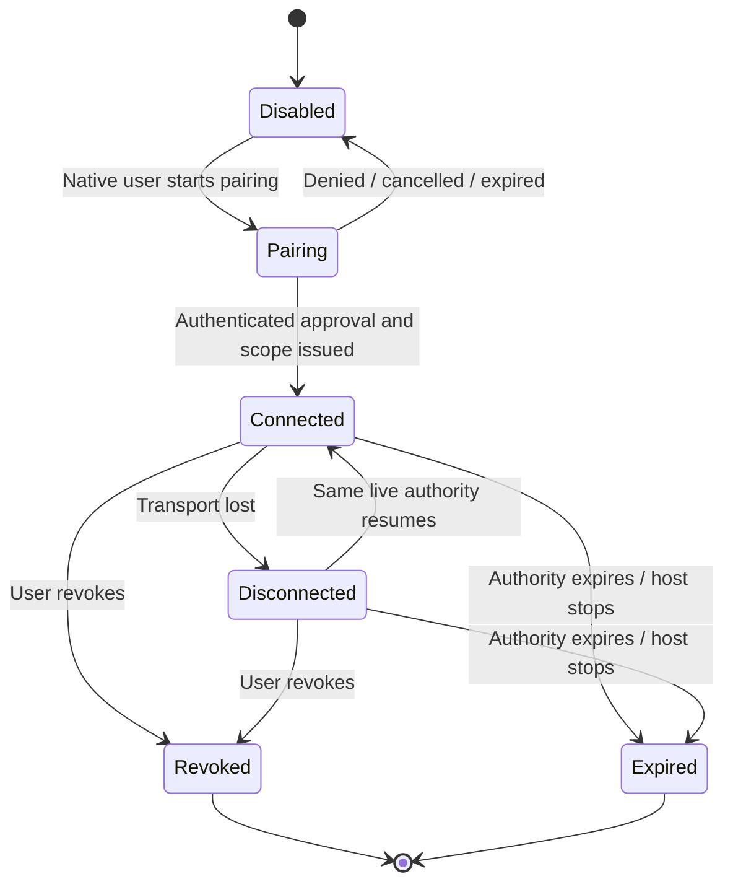
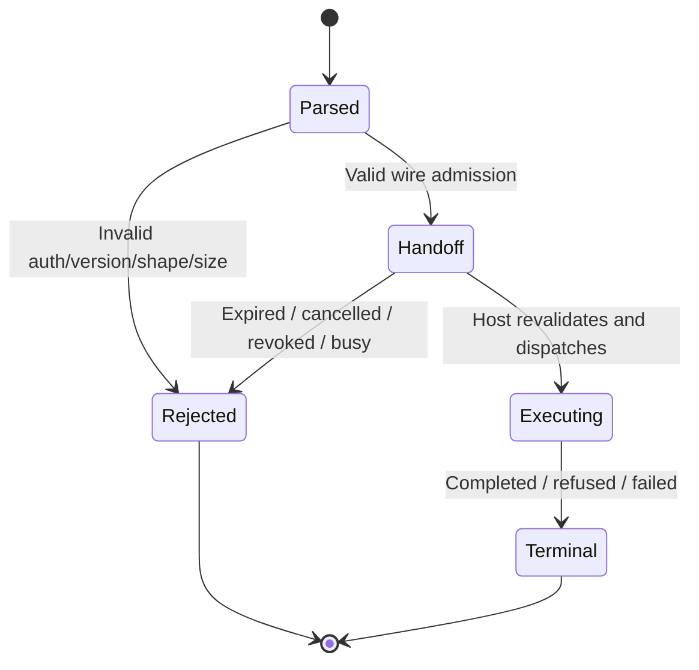

# Phase 3a1 proposed contracts

DATE: 2026-10-17
STATUS: Superseded by the implemented contracts in `context/` (CONTRACTS, AGENT_INTERFACE). Kept as the design record.
ISSUE: none (local planning draft)

Existing [CONTRACTS](../../../context/CONTRACTS.md) and
[AGENT_INTERFACE](../../../context/AGENT_INTERFACE.md) remain authoritative. This file describes
the delta to implement, not an available API. Code/tests cite the durable authority after it is
updated, never this plan or its stage IDs.

## 1. Public API integrity and metadata

Own and freeze Model session IDs, caller handles and effective capability values. `connect` remains
the trusted in-process API; external JSON never directly obtains it or supplies effective grants.
Pending/completed invocation replay compares operation, params, expected revision and preview digest
before returning a retained outcome. Existing 256-outcome/15-minute retention remains the baseline.

Derive the minimum grant from operation kind and declare actual per-operation effects/additional
scope. Kind alone does not prove absence of Model effects. Keep enforcement and description
generation in agreement, and resolve D13 before exposing navigation-triggered protection. Descriptions expose
input/result schemas, examples, refusal sets, confirmation/approval and relevant preconditions.
Preconditions describe what a caller can prepare, not copied business validation implementations.

Publish a bounded Model-context read with session/revision, edit path, selection summary and readiness
reason. Selection/camera changes are not Model revisions; view-specific generation/provenance must
track them where relevant. Selection-page cursors bind selection/view generation as well as target
and query, so a selection change without a Model revision expires the old page. Detached values never
expose live SketchUp objects. Public wire request,
outcome and context-description schemas are generated/tested alongside operation `value` schemas.

## 2. Bounded Space access and edit shapes

Under D3a1-03 `ph_composer.spaces.list` is reshaped in place: totals computed before filtering, rows
as summaries with a `fields` projection, children and findings moved to `spaces.volumes.list`,
`spaces.floor_segments.list` (scoped to an explicit Space or Volume) and `spaces.findings.list`;
`spaces.all` stays whole for the panel. 04 adds `spaces.candidate_faces.list`. Each reshape is one
`MINOR` bump and one changelog line (D3a1-10); no legacy twin is kept. No adapter-specific Space
read or independent calculation is introduced.

Summary rows carry occurrence reference, requested editable/derived fields, counts and bounded
finding summaries. Child pages are scoped to explicit Space/Volume references; candidate pages
include unmarked and eligible loose Faces plus eligibility/refusal information. Full loops/geometry
and metadata are opt-in detail, with explicit size/continuation policy. Typed units and authored versus
derived/missing values remain apparent. Projected output must actually omit unrequested values.

All cursors bind session, operation, filters/projection/order and revision using existing paging
semantics. Never silently truncate an oversized row. Keep a deterministic path/ID order. Aggregates
are computed from complete model rows before filtering, with one declared model/Zone/segment scope.
Row count is not byte boundedness: large strings, child counts and global findings need budgets too.
Read CPU/latency budgets are measured separately from serialized response size.

Space, Volume and Floor Segment edits take typed `values` and `expected_values` per kind, with
units and null meaning clear; runtime validation and expected-value checks remain. The open-object
shape is replaced under D3a1-10, not kept beside the typed one.

## 3. Context navigation

Under D3a1-04 the foundation owns navigation: `ph_composer.context.open(path)` and
`ph_composer.context.root`, view commands registered in `FOUNDATION_FEATURES`. They take an explicit
root-to-occurrence persistent-id path and an optional `expected_path`, refuse a locked entity on the
path (`target.locked`), an unresolved step (`target.not_found`) or a changed current path
(`target.edit_path_changed`), and run through `EditContext.enter` so every registered boundary
fires. Nothing else assigns the active path. Spaces' `context.open` and `context.close` stay as
reference-aware conveniences; Zones gains no navigation.

Under D3a1-13 the view contract reads: a view command writes no authored data and creates no Undo
entry of its own; it may trigger the Model's own protection boundaries, which each command declares
in `side_effects`. `ViewCommand` gains `side_effects`; the two foundation commands, Spaces'
`context.open` and `.close` and `locate` declare the Volume lock; the `view` consent copy names it.
A context change advances the Model revision as today. C05 measures the lock, path, revision and
Undo effect for a `view`-only caller and the declaration must match the measurement.

## 4. External connection and scope

The records below are the plan's original, heavier authority model. Under D3a1-05 as revised on
2026-10-17 the connection is the token (label, capability set, revoke) and the pairing request,
execution principal and diagnostic event rows are alternatives Ed can choose, not the default.
Conceptual records, with final schemas/limits frozen in 06:

| Value | Required meaning |
| --- | --- |
| Host instance | Random process identity, extension/API versions and transport endpoint identity; changes on restart |
| Pairing request | Short-lived nonce, requested named scope, pending/approved/denied/cancelled/expired state; no live Model grant before approval |
| Connection | Authenticated opaque ID, display label, current status, effective capability ceiling, approved session IDs and location IDs, timestamps/expiry |
| Execution principal | Host-owned binding from connection to caller for one Model session; immutable to requests |
| Connection status | Connected/disconnected/revoked/expired, with outstanding request/task summaries; disconnected differs from revoked |
| Diagnostic event | Bounded request identity, method, target references, revision/outcome and timing; no full model payload, secret or unrelated path |

Native users can approve/inspect/revoke a named connection without opening a model authoring draft.
The UI explains `read`, `view`, `model_write`, machine-wide `setup`, `export`, and any image scope.
Setup can change this installation's libraries across sessions; do not label it a Model-only grant.
Default external consent is read-first. Pairing credentials stay outside SKP data, public results,
logs and repository configuration. Denied clients cannot enumerate unapproved model filenames.

One connection maps to stable per-session callers. Reconnect can recover those callers only while
the same host/connection/session authority is alive and valid. Reopen or restart never rebinds by
path/name. Individual revocation ends admission, cancels pending handoffs and invalidates unused
artifact/capture access according to the agreed policy; it does not delete the user's output files.

## 5. Application envelope, receipts and host execution

Under D3a1-01 the external envelope is MCP JSON-RPC over loopback HTTP, served from Ruby. Each
tool call names the Model session, the operation and plain-JSON params; `invoke` adds the expected
revision, an optional client idempotency key and an optional proposal digest. The bearer token
travels in the `Authorization` header, never in params. Never use arbitrary `eval`, `send` or a
request-provided Ruby method name. Tools are an explicit allowlist of the public API verbs
(D3a1-09), each mapped to one `PhComposer::API` method.

MCP request identity correlates protocol messages; it does not replace application mutation identity.
Under D3a1-14 the ingress assigns each caller's sequence: a repeated idempotency key replays through
the existing retained outcome, a repeated key with different input is `request.sequence_conflict`,
a key whose outcome has expired or been evicted is `request.outcome_unavailable` and is never given
a new sequence (the key store lives at least as long as the caller's `highest_sequence`), and every
result carries the sequence it ran under. Side-effecting `view`, `setup`, `export_file`
and `start_export` calls keep no second ledger: a lost reply is recovered by reading state, which the
existing contracts already make possible (`location.used` after one add, one task per session plus
`latest_export`, the Model-context read after a context change). The operating guide teaches that.
Keep one authoritative invocation outcome.

Network threads parse and authenticate plain data only; no SketchUp object is touched off the main
thread. A bounded transient handoff (the bridge's queue-and-pump pattern) schedules the work on the
host thread. It is not a durable edit queue and does not wait out modal conflicts. At execution,
recheck session, token, grants, readiness and current revision/reference preconditions.
Oversized or malformed requests and full or expired handoffs refuse before acceptance. No native
transaction stays open while awaiting the network, a person or an LLM.

Pump liveness: Ruby threads in SketchUp run only while the main thread yields, so during a modal
dialog or a long native operation the pump does not tick and the main thread cannot answer at all.
The design is that the network thread answers `session.busy` itself, touching nothing in SketchUp,
when the pump has not ticked within a declared bound; the asset server's `max_pump_ms` measurement
is the model for that signal. Whether the acceptor thread runs at all while a native modal is open
is a host fact nobody has measured; V2 measures it. If it does not run, the client sees its tool
timeout and the operating guide says so. The bound and the client tool timeouts it must stay under
(Codex defaults to 60 s) are recorded with D3a1-12.

Transport disconnect after acceptance leaves an uncertain reply, not proof of cancellation. A client
retrieves its receipt/outcome. Explicit cancellation may remove unaccepted queued work; accepted
actions use their normal atomic contract, and export cancellation uses the task stage contract.
Refusal/failure envelopes preserve `effect` including `unknown` rollback state and resulting revision.
Do not replace domain codes with raw exception text or claim `none` for an uncertain commit.

## 6. Approved file scope and export revocation

Keep native machine approvals and existing opaque location IDs. Under D3a1-05 any token holding
`export` may use any approved destination, as any in-process caller may today; per-token location
allowances are the listed alternative. Export task ownership records the caller handle that started
the task; another caller cannot poll or cancel it merely because both have `export`, and an agent's
`latest_export` never answers a native-started task.

Recommended revocation promise (D3a1-06): a revoke is a main-thread store write and
takes effect before the next pump tick; queued and pre-commit external writes are then blocked. Export
rechecks the owner's access and the approved location immediately before pair commit, together with
model-generation and destination-state checks. Already irreversible writes complete or fail
truthfully; no false cancelled/none result. Define native-started task visibility explicitly.
Client disconnect alone does not cancel a session-owned export.

## 7. Produced artifacts

Under D3a1-07 there is no handle and no byte retrieval. After the pair is renamed into place, the
task outcome of the caller that started the run carries `artifacts`: run id, source revision and
export generation, the approved location's id and label, and for the HBJSON and the report their
absolute path, SHA-256 and byte size, computed where the pair is verified. The key is absent before
commit, on refusal or cancellation, for every other caller and for a native-started task polled by
an agent; an expired task id discloses nothing. The agent reads the files with its own tools and
compares the hash first: a later run to the same destination replaces the files, and the earlier
task keeps reporting its own hashes, which then no longer match. Status stays compact and paths never
enter logs or the ingress diagnostics. Chunked retrieval is the listed alternative, needed only by a
remote client that is out of scope.

## 8. Visual state and capture

The `context` read carries session, revision, edit path, selection summary, camera parameters and
a view generation that advances on camera and selection changes without a Model revision. Framing
stays `locate`.

Under D3a1-08 capture is `ph_composer.view.capture`, a view command under its own capability,
`capture`: `View#write_image` at the current camera, no zoom, selection or path change, a PNG under
2 MB in a per-session temporary folder, and an answer of path, SHA-256, bytes, dimensions, time and
provenance (session, revision, view generation, camera, edit path, selection digest) with
`overlays: "not_included"` stated. The agent reads the file with its own tools, as it reads an
export under D3a1-07. Four captures per session are kept for 15 minutes. A view change between the
pre-check and the write refuses; no image is labelled current that is not. Panels are never
captured. `ViewCommand` gains an optional `capability` so one view command can need a grant other
than `view`; the MCP `view` tool exposes it like any other command and dispatch applies the declared
grant. The states 14 measures (hidden, behind, minimized, modal) each refuse or capture as recorded.

## 9. Client packaging and schema generation

Under D3a1-09 the tool list is the public API verbs with fixed schemas; operation schemas come from
`describe`, so an outside feature works with no adapter change by construction. Participants and
development-only routes are not reachable because no tool maps to them. Ingress applies a final
response size policy. Preserve units and refusal recovery details. Map business refusal into
structured tool data, distinct from protocol failure. Per-operation typed tools, if ever tried,
are generated from declarations and compared against this surface in both clients.

Pin the MCP protocol version the Ruby server answers and verify it against exact client versions;
there is no SDK to pin. The protocol layer runs under the offline stub and joins the normal gate.
Installation is the RBZ plus the config snippet the access dialog shows; no client config changes
occur in this planning phase. The shared guide is independent of repository-development skills.

## 10. Proposed state transitions

Under D3a1-05 the connection's states are three: a token is issued, live, then revoked (a tombstone).
It carries no per-Model grant; sessions are named explicitly on each call, and a closed Model's
session id is simply unknown afterwards. The first diagram below is the pairing model Ed may still
choose, kept as the alternative; the second still constrains the ingress. Names are conceptual, not
new persisted enums.

In the alternative, re-pairing creates new authority and old caller recovery is allowed only through
the authenticated resume path. In the accepted token model the token itself is the resume path: the
ingress keeps one caller handle per token and open session, so a client that restarts keeps its
sequences and retained outcomes until the session closes or the token is revoked.

Wire admission and API mutation acceptance are different events. Only existing dispatch acceptance
takes a Model mutation sequence. A handoff receipt may exist for an authentication/size-valid request
that later refuses before that acceptance; it must not claim a consumed sequence or Model effect.
Matching retries replay the same receipt/outcome; changed intent conflicts. Non-Model side effects
use their receipt identity. A client losing the reply observes uncertainty and queries status; it
does not change the host request state to failed. Process loss/eviction can yield unknown history,
which requires read-back before issuing new intent.

An export has a separate session-owned task state and cancellation cutoff inherited from the
existing task contract. Revoke acknowledgment prevents not-yet-committed external work under the
selected policy; transport loss alone does not. Artifact/capture handles transition available to
expired/revoked/changed-unavailable and never revive as a different run's bytes.
