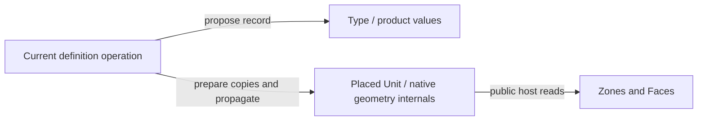
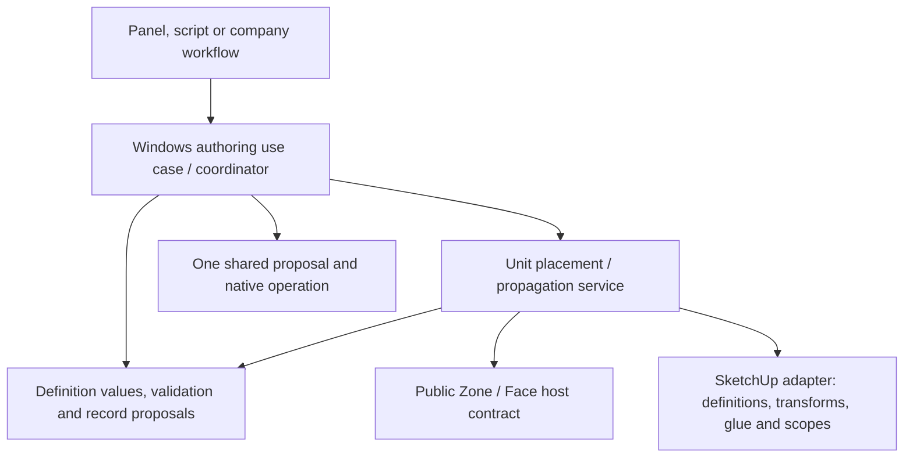

# Windows: domain independence and contextual authoring

DATE: 2026-10-13
STATUS: Source-backed rationale; recommended boundary and initial repair policy accepted by Ed 2026-10-13. No implementation.
BASELINE: `cfe01a6aad99a0e09d5ecf0de5659c606d7ba4f9`

Ed asked whether the Window can be an atomic low-level entity, with Zone composition above it,
and why the current implementation reaches into context. The answer depends on distinguishing a
reusable definition, a placed occurrence and the application operation that coordinates a change.

The desired independence is workable. SketchUp imposes contextual placement and shared-geometry
constraints; it does not require product/Type records or their intrinsic rules to depend on Zones.
The current model substantially respects that distinction. The remaining issue is where the
application coordination lives and how precisely the architectural authority describes it.

## 1. Three different meanings of Window

| Responsibility | Data / rule | Context requirement |
| --- | --- | --- |
| Products | Frame, Glazing and Psi-Install Type authored values | No Zone or placed Unit needed to construct or validate their values |
| Window Type | Exact-size grid, glazed/Empty elements, product references, operation and perimeter installation choices | Needs its explicit definition inputs; no Zone needed for intrinsic grid/thermal/outline rules |
| Window Unit record | Independent `wun_` id, Type reference, anchor and metadata | Record values can be represented without a live host; an occurrence also has a native transform and glue |
| Place / resize / rehost / export use case | Resolve a host, compute position, check fit, update native geometry, coordinate references and Undo | Necessarily contextual; belongs above the definitions and host records |

Creating definition values is different from persisting them in a particular Model, and both differ
from placing a cutting component on a Face. A persistence operation needs a datastore; a physical
placement needs an explicit host. Neither implies that the reusable domain definition knows them.

There are already pure rules: [Types::Grid](../../src/ph_composer/features/windows/types/grid.rb),
Type/product thermal calculations and [DefinitionPlan.build](../../src/ph_composer/features/windows/units/definition_plan.rb#L16)
consume explicit records to produce detached values. DefinitionPlan lives under `units/` but reads
no live native entity. This is an existing basis for the cleaner boundary.

## 2. What we deliberately chose, and why

The original [Window interview](../archive/window-types/PRD.md#decision) chose plain generated
components on 2026-09-18, later integrated with the revised downward-layering decision on
2026-10-01. The choices should be documented individually rather than as one blanket exception
for the entire Windows feature.

### One shared generated component per Type

Every canonical Unit is an instance of the Type's one generated primary ComponentDefinition.
The component is flat, with a Face per glazed element; it glues to and cuts its host. This gives
native Move/copy behavior, a real opening and shared geometry. The interview compared it with
a Group per Unit and stamped sub-faces: those alternatives require rewriting every separate
Unit's geometry and have different native editing/recovery costs.

No .skp template or Dynamic Component is required. [The current primary-definition contract](../../context/CONTRACTS.md#geometry-records-and-occurrence-references)
uses an index and Type mark, not a display name. Make Unique produces a detached definition;
Reset to Type deliberately reassociates it. A Type rewrite does not silently rewrite detached copies.

### Every Unit follows its Type, without per-Unit product/install overrides

Changing the Type's products or installation choices changes the referenced definition values.
Changing size/layout also regenerates the primary geometry. Each instance is translated so its
own selected anchor stays fixed. Type record and native changes commit together: one Undo restores
both. This avoids a Type that says one thing while its placed geometry says another.

The [used-Type behavior](../archive/window-types/PRD.md#editing-a-used-type) requires checking
whether the new outlines leave a host or overlap other Units. A 1.2 m wide Type cannot be accepted
blindly if one instance sits in a 1.1 m available opening. That fit decision belongs to the edit use
case, using Type-derived outlines and explicit host data, not to the Type's intrinsic validator.

The current [TypeChangeStep](../../src/ph_composer/features/windows/units/type_change_step.rb#L23)
handles primary-definition users, transforms, anchor preservation, supplied host geometry and fit,
then rechecks its native guard at apply. Historical [P2-12 evidence](../archive/phase-02-envelope/evidence/p2-12-window-unit.md)
records native resize/anchor/Undo and refusal behavior. This discussion does not renew that evidence
or establish support-floor acceptance.

### Native copies are allowed; reads never repair them

SketchUp copies the Unit dictionary along with an instance, so native copies initially share the
authored Unit id. [Interview Q21](../archive/window-types/PRD.md#records) chose repair on the next
Windows mutation, inside that mutation's Undo step, rather than repair during a read or requiring
every native copy to enter a separate command. The stated original reason was that a Unit's authored
content was its Type and anchor, so a new identity could preserve its values without a separate
per-Unit variant choice. Current structured metadata must also obey the declared copy rules.

That convenience policy is broad: creating an unrelated Frame is a Windows mutation too. The
current [Units::Mutation.prepare](../../src/ph_composer/features/windows/units/identity_step.rb#L50)
therefore scans all Units before that Frame is staged. A locked/shared copied Unit can refuse the
otherwise unrelated definition edit. This is a chosen trigger, not a native requirement that all
definition creation must depend on placement geometry.

A named Repair copied identities action also exists. The separate
[copied-Zone Windows packet](../features/unscheduled/copied-zone-windows/README.md) proposes
repairing copied children in the Zone-copy follow-up, without Zone code naming Windows. It remains
scoped by the [child lifecycle plan](../archive/zone-child-lifecycle/PLAN.md), with implementation
unauthorized. It adds copied-parent repair while retaining the broad Windows fallback.

### One feature package spans definition and placement layers

[D2-1](../archive/phase-02-envelope/DECISIONS.md#part-2-decisions-for-ed) deliberately keeps Windows
as one cohesive feature while assigning its definitions to the lower layer and Units/placement
above Zones. Windows' placement code uses public Zone Face reads and locators. Zones requires
Assemblies, but never Windows. Net opaque area belongs to the layer knowing both Faces and Units,
so Zones does not acquire a reverse dependency just to display that derived fact.

One feature namespace is not itself an onion violation. It does make the registered package's
`requires` coarse: the whole Windows feature requires Zones/Library even though its pure rules
do not. Separately installing a definition-only feature would be a further packaging decision;
it is not required to separate pure rules from contextual application services inside this package.

## 3. Where context legitimately belongs

A Window's *placed use* must resolve a writable Face occurrence and its native coordinate system,
obey glue/cutting rules, preserve anchors, detect shared/locked storage and check its outline against
the host and other placed uses. Export must attach the resulting Apertures to Faces and ultimately
Rooms. These are relationships between objects; an intrinsic Window definition cannot decide them
from its own data alone.

The current [Placement::Hosts](../../src/ph_composer/features/windows/placement/host.rb#L16)
uses declared Zone reads and the Face locator. It does not read Zone dictionaries. Authoring allows
some incomplete host states that export later reports; do not equate writable placement with every
canonical export condition being satisfied. The current product export semantics use Wall or
RoofCeiling with Outdoors; paired Surface placement refuses.

Units carry no redundant Zone stamp: containment is derived from native storage. A pasted orphan
Unit can exist outside a Zone and still participates in identity/reference checks. The data layer
must be able to represent that incomplete state so it can be diagnosed and recovered, even though
valid placement/export ultimately needs a host.

Installation choices are another distinction. The Type presently includes selected installation
junction definitions and an install-depth override; that is an explicit installation specification,
not a computation inferred from its owning Zone. A Frame product remains reusable across walls.
Changing those product semantics is not needed to separate application coordination from pure rules.

## 4. The actual architectural issue

[Products::Operations](../../src/ph_composer/features/windows/products/operations.rb#L12) and
[Types::Operations](../../src/ph_composer/features/windows/types/operations.rb#L12) combine record
proposal construction with Unit identity preparation. Type operations additionally call Unit native
changes and usage counts. Thus the callable that appears to be the lower definition-persistence
operation also knows the placement lifecycle.

It is legitimate for a higher-level **Edit Window Type** use case to coordinate both. The pure
Type entity is not made invalid merely because its edit use case knows placed uses. The issue is
that the current contract/layout treats that same operation as the reusable lower-layer definition
operation, without a distinct context-free record-proposal path. The architecture text's unqualified
claim that definition behavior names no geometry is consequently too broad for this code.

The fix need not change visible behavior: separate the definition value/proposal operation from
the feature-owned application coordinator. That coordinator can retain the same repair, reference,
fit and one-Undo policy while a contributor making a definition-only change no longer learns Unit
internals. Native changes remain owner-proposed steps, not side effects of reading a definition.

Proposed dependency structure, with coordination above the responsibilities it composes:

This recommendation uses the existing feature grouping. It does not require splitting Windows
into separately distributed packages, weakening host checks or letting the Type call a global event
bus to find its users.

## 5. Zone as parent versus Zone as coordinator

Ed's proposed composition is appropriate as a logical model: a Zone contains Spaces and its Faces
host Window Units and Assembly assignments. But **the logical parent need not be the implementation
owner of every child's lifecycle**.

If Zone directly imports Windows, Spaces and every future child package while those packages need
its Face/containment contract, the implementation graph becomes cyclic. It also makes a new child
feature require edits in Zone's core logic. That would undermine the contributor platform goal.

Instead a higher-level authoring operation composes parent and child operations, or the parent
publishes a generic contribution contract for a containment/copy transition. The child owner
contributes its own validated steps. Zone never rewrites child dictionaries. The same proposal
can still represent one atomic user gesture, even though each owner supplies part of it.

Assemblies already demonstrate the intended distinction: Assembly definitions know no Faces;
Zones owns Face assignment and contributes Assembly usage/retargeting. Spaces will have a similar
split between portable authored values/rules and contextual Groups/Volumes/Floor geometry. A Space
is presently a placed group within a Zone, not an implemented reusable Space Type, so it should not
be described as identical to an Assembly definition.

## 6. Documentation correction and remaining decisions

The initial RF-02 review incorrectly said copy repair was omitted from discovery. Its primary
effect string is wrapped by [Shapes.side_effects](../../src/ph_composer/features/windows/declarations/shapes.rb#L24),
which appends the repair statement. That claim is withdrawn in the section and findings register.
The structural dependency and locked-copy consequence remain.

Historical sources establish the representation, propagation, repair trigger and feature grouping
choices. They do not establish that putting `Units::Mutation.prepare` in each definition operation
was an independently accepted permanent exception to onion layering. The review should describe
it as the current implementation of the accepted policies, with a boundary that can improve.

Direction accepted by Ed on 2026-10-13, with implementation still planning-only:

- **Keep intrinsic definitions independent, keep placement contextual, and coordinate above both.**
  This is compatible with current behavior and needs no product concession.
- **Initially preserve one Type/primary-definition relationship and atomic used-Type propagation.**
  Per-Unit product/installation variants would be a separate product change and are not proposed here.
- **Decide repair timing separately.** Recommended first refactor: retain next-Windows-action repair
  in the coordinator so structural changes are testable without changing policy. Then decide whether
  unrelated catalog edits should stop triggering repair, alongside copied-Zone child participation.
- **Use generic parent/child contribution contracts rather than teaching Zone every child's internals.**
  The ordinary action composition plan is the first boundary; restorable native-copy follow-ups need
  their own design and host acceptance, since they have different failure/Undo mechanics.

Before implementation, update the accepted architecture authority to distinguish definitions,
owner use cases and native adapters precisely, and record any changed repair policy. This discussion
does not itself authorize source implementation.

The [shared Zone-child pattern](../archive/code-review-refactoring/ZONE_CHILD_PATTERN.md) records the accepted direction for
Windows, Spaces and future entities. The [Windows plan](../archive/windows-orchestration/PLAN.md)
and [child-lifecycle plan](../archive/zone-child-lifecycle/PLAN.md) separate ordinary authoring from
native-copy restoration and give their own acceptance gates.
