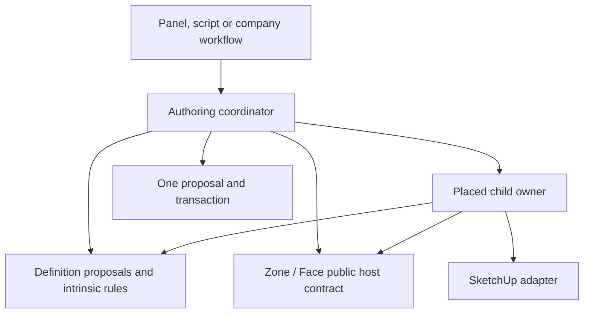

# Reusable definitions and Zone children

DATE: 2026-10-13
STATUS: Architectural direction accepted by Ed; concrete APIs remain proposed and unimplemented.
ISSUE: none (local planning draft)

## Decision and rationale

Ed accepted this direction on 2026-10-13 after the [Windows discussion](../WINDOWS_BOUNDARY.md).
Use the same responsibility split for Windows, Spaces and future Zone children such as mechanical
equipment. A reusable definition validates its explicit values without a Zone. A placed occurrence
represents a use of those values in a host. An authoring service coordinates their relationships
through owner operations and one proposal. Native adapters perform the SketchUp work.

The split lets a firm construct, compare or import definitions without a geometry fixture. It also
lets a placement workflow enforce host-dependent constraints without making every product validator
depend on the entire building. Logical containment describes the Model; it does not dictate Ruby
imports. A Zone can contain a child while its implementation knows only a generic transition contract.

This is an accepted design direction, not a claim that a child API or reusable Space Type exists.
The current authority remains [EXTENSIBILITY](../../../context/EXTENSIBILITY.md). During implementation,
amend its overly broad statement that definitions know nothing about geometry: a Type may own intrinsic
outline geometry derived from values, but must not depend on live placement or its users. Keep the
distinction between domain values, persistence proposals, application coordination and host adapters.

## Responsibilities

| Owner | Inputs and responsibilities | Must remain outside it |
| --- | --- | --- |
| Definition values/rules | Explicit dimensions, product references and intrinsic validation; detached derived values | Live Zone lookup, placement scans, native mutation, shell Registry access |
| Definition proposal service | Own store/engine context, record validation and declared reference plan | Direct imports of child placement implementations |
| Child occurrence owner | Identity, reference to any definition, own authored values, occurrence path, metadata and child-specific rules | Parent dictionary writes or inference that native persistent ids are durable authored identities |
| Parent owner | Zone/Face values, containment/host reads, own storage and identity transitions | Window/Space/equipment schema branches or rewriting child dictionaries |
| Authoring coordinator | Explicit dependencies; definition and placement proposals; participant refusal and atomic outcome | Domain calculations duplicated in JavaScript, hidden event-bus dispatch, separate nested transaction |
| Native adapter/step | Targets, guards, mutation scope, native apply and applicable restoration | Business dependency discovery or repair during reads |

A feature package can span these responsibilities. Shared folders do not prove dependency direction;
tests and explicit inputs do. Keep Windows as one package initially. A feature-local coordinator can
call explicit collaborators directly. Cross-feature mutations use the [composition contract](../../archive/cross-feature-composition/PLAN.md).

## Three workflows

**Construct a definition.** Validate explicit values and declared references; propose an owned record.
The low-level proposal can run without a placed child or native geometry. A public Windows action may
still run the accepted identity-repair policy through its coordinator. Moving that policy upward does
not silently remove it from the user action.

**Place or edit a use.** Resolve an explicit host occurrence and read relevant definitions. Compute
detached placement/geometry facts, validate fit and ownership, and propose guarded native steps with
the record changes. Refusal leaves the entire ordinary action unapplied. A definition edit that affects
existing uses asks their owner to contribute propagation. Type validity and placement suitability are
different checks.

**Copy a parent.** Bind the parent-copy transition, establish independent storage and remap each owner's
copied collection under its own rules. The parent supplies containment; children supply their copy plans.
Ordinary explicit Make independent can abort its operation. A native-copy follow-up cannot abort the
user's gesture and must restore its own writes on failure. These execution policies are separate even
when they use the same transition description and child plan.

## Child-copy contract direction

The [Zone-child lifecycle plan](zone-child-lifecycle/PLAN.md) owns the concrete design. Proposed inputs
are the copied occurrence path, the old and new Zone ids, the id mapping Zones allocated, the
revision and the execution mode (explicit or follow-up). Outputs describe owned targets, copy/reference remaps, guards,
restorable work and affected occurrences. Contributions are synchronous and explicitly registered.
Do not substitute unstructured notifications that each listener turns into its own transaction.

Parent isolation can replace descendant native paths. Bind previews to logical content and identity
mappings, then materialize final paths after isolation and revalidate before owner writes. A saved
pre-isolation path is insufficient proof of a final write target.

| Child | Copy semantics to preserve |
| --- | --- |
| Window Unit | New Unit identity; existing Window Type retained; own metadata copied under its declarations; original Unit unchanged |
| Space | Independent storage/identities for Space, Volumes, Floor Segments and logical Space Floors; copied membership and typed internal references remapped; values preserved |
| Future mechanical equipment | Apply the same ownership pattern; determine definition sharing, instance identity, host relationships and dependent network copying in its product packet |

Window and Space outcomes follow [D3a-13](../../features/phase-03a-spaces/DECISIONS.md#confirmed-copy-decision-d3a-13).
Equipment is an example of an adopter, not an accepted copy policy. A pipe/duct network crossing Zones
cannot be handled correctly by inventing a generic deep-copy rule here. Likewise, deletion, movement
and rehosting require their own declared transitions and product decisions when introduced.

The current [equipment draft](../../features/phase-04-mechanical/equipment/PRD.md#the-shared-shape)
describes an item that serves one or several Zones through assignments; it does not require a physical
child Group. Apply the ownership split to that relationship too. A served-by association need not be
represented as native containment, and a copied Zone does not automatically duplicate its shared ERV.
The equipment packet must settle that policy without making equipment definitions depend on Zone internals.

## How refactors must record this pattern

Each owning packet must name the reusable values, placed identity, parent contract, coordinating use
case and native adapter. Trace successful preparation through apply/read-back, and trace refusal and
partial native failure. State why a rule needs host context and why that context is supplied at its
chosen level. Link historical product decisions instead of describing every dependency as an exception.

When implementation lands, update the relevant sections of EXTENSIBILITY and CONTRACTS with the actual
public API and a Windows example. The Spaces packet links the shared contract rather than cloning it.
An outside synthetic child must participate without a feature-name branch in Zone, shell or session.
Keep discovery and generated examples synchronized with supported behavior. A passed built-in test is
insufficient evidence that an outside child can use the same contract.

## Evidence and limits

Windows retains the generated shared primary component, anchor preservation, atomic Type propagation
and next-Windows-mutation repair. [Windows orchestration](windows-orchestration/PLAN.md) moves their
coordination without changing those policies. The native child-copy plan adds copied-occurrence repair
while retaining the broad fallback; narrowing unrelated catalog triggers remains a later decision.

No hot loader, untrusted Ruby sandbox, portable package release or equipment schema is implied.
SketchUp 2023, Windows OS support, exporter and distribution gates remain independent. Planning-only
acceptance verifies coherent contracts; actual extensibility needs the owning offline and native receipts.
